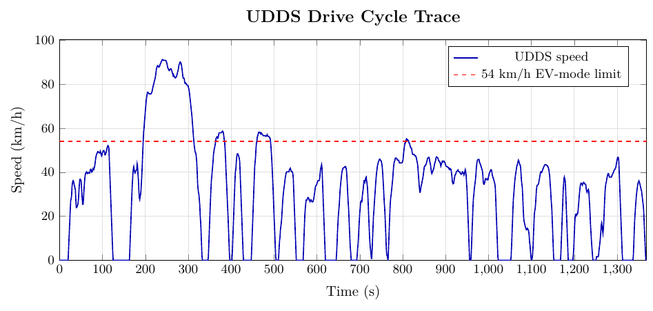
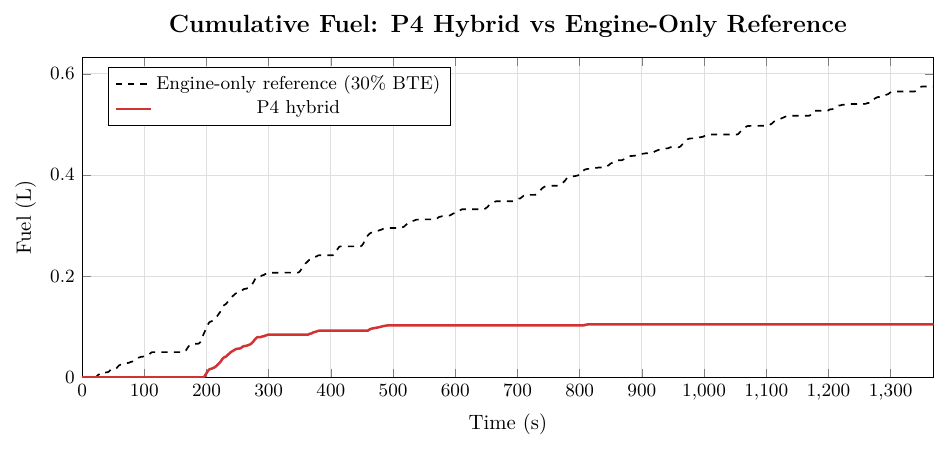
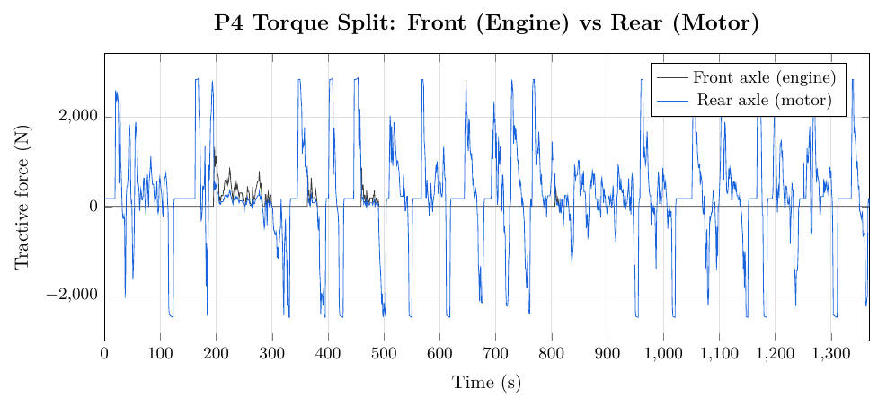
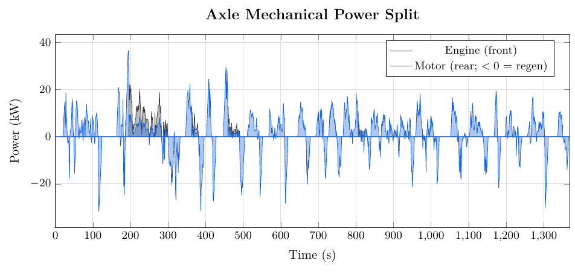
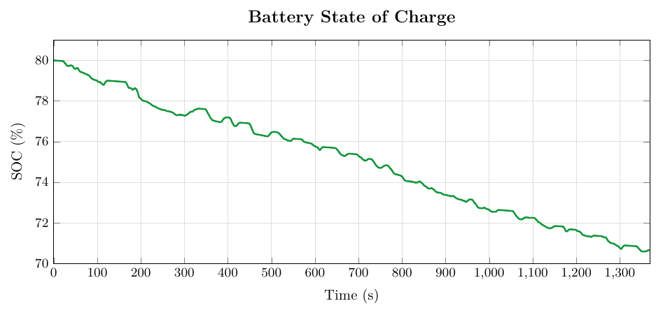
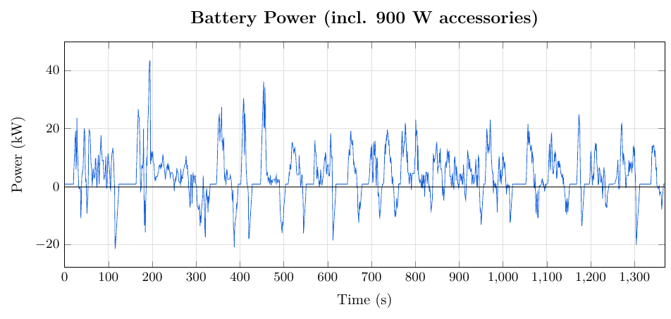
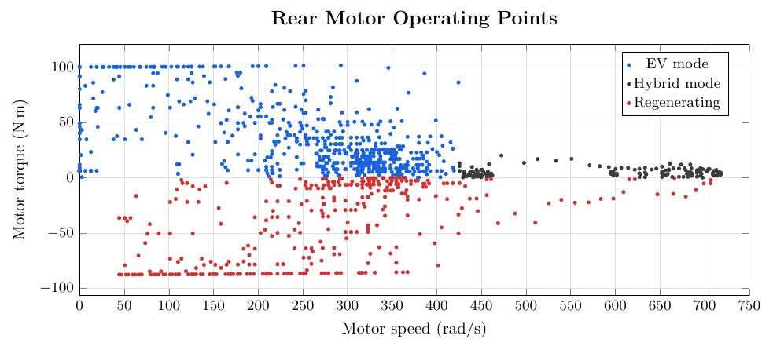

# P4 Parallel Hybrid Powertrain: Heuristic Energy Management, Torque Split and Fuel Economy under the UDDS Drive Cycle in MATLAB

## Abstract

This project presents a backward-facing simulation of a **P4 (through-the-road) parallel hybrid electric vehicle** implemented entirely in **MATLAB**, using the **EPA Urban Dynamometer Driving Schedule (UDDS)** as the driving input.

In a P4 architecture the two power sources are mechanically decoupled and act on different axles:

- A **100 kW petrol engine** drives the **front axle**
- An **80 kW / 250 Nm electric motor** drives the **rear axle**
- A **15 kWh plug-in hybrid battery** supplies the motor

The simulation integrates:

- Vehicle longitudinal dynamics
- A rule-based (heuristic) **Energy Management Strategy (EMS)** that decides the front/rear torque split
- EV-only, hybrid and regenerative-braking operating modes
- An operating-point-dependent motor/inverter efficiency model
- Engine fuel-flow estimation from brake thermal efficiency and fuel heating value
- Battery State of Charge (SOC) tracking including accessory loads

The model shows how a simple EMS distributes traction between the engine and the motor over an urban cycle, and quantifies the resulting **fuel consumption, electric-drive share, regenerative-braking recovery and battery depletion**.

---

# Contents

1. [Introduction](#1-introduction)
2. [System Modeling Architecture](#2-system-modeling-architecture)
3. [Mathematical Modeling](#3-mathematical-modeling)
4. [MATLAB Implementation Methodology](#4-matlab-implementation-methodology)
5. [Simulation Results and Performance Metrics](#5-simulation-results-and-performance-metrics)
6. [Model Limitations and Known Issues](#6-model-limitations-and-known-issues)
7. [Learning Outcomes](#7-learning-outcomes)
8. [Repository Structure and How to Run](#8-repository-structure-and-how-to-run)

---

# 1 Introduction

## 1.1 Objective

The objective of this project is to study the **transition from a pure battery-electric powertrain to a P4 parallel hybrid architecture** and evaluate, under a real driving cycle:

- How a heuristic EMS splits tractive force between the front-axle engine and the rear-axle motor
- The share of driving covered in pure electric mode
- Engine fuel consumption compared with an engine-only vehicle
- Regenerative braking effectiveness on the rear axle
- Battery SOC depletion over the cycle
- Engine and motor operating points relative to their ratings

The vehicle body, road-load and motor-efficiency models are carried over from the BEV study [EV Powertrain Dynamics, Battery Electrical-Thermal Modeling and SOC Estimation](https://github.com/atharvaajaynikam4601-netizen/EV-Powertrain-Dynamics-Battery-Electrical-Thermal-Modeling-and-SOC-Estimation-using-Kalman-Filter-), so the effect of adding an engine on a second axle can be isolated.

---

## 1.2 Tools and Libraries Used

**MATLAB**

The entire simulation is implemented in MATLAB using numerical methods and built-in functions.

Key MATLAB functions used:

- `readtable()` → Import drive cycle dataset
- `diff()` → Numerical differentiation to compute acceleration
- `trapz()` → Numerical integration for distance and fuel calculations
- `min()` / `max()` → Saturation of efficiencies, motor force and SOC
- `subplot()` / `plot()` → Result visualization
- `fprintf()` → Structured result reporting

---

## 1.3 Input Dataset

The simulation uses the **EPA Urban Dynamometer Driving Schedule (UDDS)** which represents **urban driving conditions with frequent stop-and-go behavior** and one short higher-speed segment.

| Parameter | Value |
|--------|------|
| Duration | 1369 s |
| Distance | 11.99 km |
| Driving Pattern | Urban |
| Average Speed | 31.5 km/h |
| Maximum Speed | 91.2 km/h |

The dataset (`uddsdc.csv`) contains **time and vehicle speed values (mph)**, which are converted into SI units before simulation.

---

# 2 System Modeling Architecture

The simulation follows a **backward-facing vehicle modeling approach**: the drive cycle defines the required tractive force, and the EMS decides which axle delivers it.

```
Drive Cycle (UDDS)
        ↓
Vehicle Longitudinal Dynamics  →  F_total
        ↓
Heuristic Energy Management Strategy (torque split)
        ↓                                  ↓
Front axle: Engine (P1, 4.0:1)       Rear axle: Motor (P4, 8.5:1)
        ↓                                  ↓
Fuel flow (BTE, LHV)                 Motor/inverter efficiency map
        ↓                                  ↓
Fuel consumption                     Battery power (+ 900 W accessories)
                                           ↓
                                     SOC update
```

The system consists of the following major modules:

1. Vehicle Longitudinal Dynamics
2. Heuristic Energy Management Strategy (EV / Hybrid / Regen modes)
3. Rear-axle Motor Efficiency Model
4. Front-axle Engine Fuel-Flow Model
5. Battery Power Flow and SOC Tracking
6. Fuel and Energy Analysis

### Powertrain Parameters

| Component | Parameter | Value |
|---|---|---|
| Vehicle | Mass | 1800 kg |
| | Rolling resistance coefficient | 0.01 |
| | Drag coefficient / frontal area | 0.29 / 2.2 m² |
| | Wheel radius | 0.30 m |
| Engine (front axle) | Max power | 100 kW |
| | Differential ratio | 4.0 : 1 |
| | Brake thermal efficiency (avg.) | 30 % |
| | Fuel lower heating value | 44 MJ/kg (petrol, ρ = 0.74 kg/L) |
| Motor (rear axle) | Max drive / regen torque | 250 / 150 Nm |
| | Max power | 80 kW |
| | Reduction ratio | 8.5 : 1 |
| | Min regen speed | 1.5 m/s |
| Battery | Capacity | 15 kWh (PHEV) |
| | Initial SOC | 80 % |
| Accessories | Constant load | 900 W |

---

# 3 Mathematical Modeling

## 3.1 Vehicle Longitudinal Dynamics

The total tractive force required at the wheels:

$$F_{total} = F_{rr} + F_{aero} + F_{acc}$$

$$F_{rr} = m\,g\,C_{rr} \qquad F_{aero} = \tfrac{1}{2}\,\rho\,C_d\,A\,v^2 \qquad F_{acc} = m\,a$$

with acceleration from numerical differentiation of the speed trace:

$$a_k = \frac{v_{k+1} - v_k}{\Delta t}$$

---

## 3.2 Heuristic Energy Management Strategy

At every time step the EMS assigns the tractive force to the two axles.

**EV mode** (motor only), when $F_{total} > 0$, $SOC > 25\,\%$ and $v < 15$ m/s (54 km/h):

$$F_{em} = \min\left(F_{total},\ \frac{T_{motor,max}\,G_{rear}}{r_{wheel}}\right) \qquad F_{ice} = \max(0,\ F_{total} - F_{em})$$

**Hybrid mode** (fixed split), when $F_{total} > 0$ otherwise:

$$F_{ice} = 0.7\,F_{total} \qquad F_{em} = 0.3\,F_{total}$$

**Regenerative braking**, when $F_{total} \le 0$ and $v > v_{min,regen}$:

$$F_{em} = \max\left(F_{total},\ -\frac{T_{regen,max}\,G_{rear}}{r_{wheel}}\right) \qquad F_{ice} = 0$$

Below $v_{min,regen}$ only friction brakes act ($F_{em} = 0$).

---

## 3.3 Motor Efficiency Model

Motor speed and torque on the rear axle:

$$\omega_m = \frac{v}{r_{wheel}}\,G_{rear} \qquad T_m = \frac{F_{em}\,r_{wheel}}{G_{rear}}$$

Normalised torque $T_n = |T_m| / T_{motor,max}$ and speed $\omega_n = \omega_m / \omega_{m,max}$ feed quadratic efficiency maps:

$$\eta_{drive} = 0.90 - 0.15\,(1-\omega_n)^2 - 0.20\,(T_n-0.6)^2, \qquad 0.75 \le \eta_{drive} \le 0.92$$

$$\eta_{regen} = 0.75 - 0.20\,(1-\omega_n)^2 - 0.30\,(T_n-0.5)^2, \qquad 0.55 \le \eta_{regen} \le 0.80$$

---

## 3.4 Battery Power Flow

$$P_{em,batt} = \begin{cases} \dfrac{F_{em}\,v}{\eta_{drive}} & F_{em} \ge 0 \ \text{(motoring)} \\[2mm] F_{em}\,v\,\eta_{regen} & F_{em} < 0 \ \text{(regenerating)} \end{cases}$$

$$P_{batt} = P_{em,batt} + P_{accessory}$$

---

## 3.5 Engine Fuel Model

Engine mechanical power and fuel power with a constant average brake thermal efficiency:

$$P_{ice} = F_{ice}\,v \qquad P_{fuel} = \frac{P_{ice}}{\eta_{BTE}}$$

$$m_{fuel} = \frac{1}{LHV}\int P_{fuel}\,dt \qquad V_{fuel} = \frac{m_{fuel}}{\rho_{fuel}}$$

---

## 3.6 State of Charge Model

Energy-counting SOC update with saturation to [0, 1]:

$$SOC_{k+1} = SOC_k - \frac{P_{batt}\,\Delta t}{3600 \cdot 1000 \cdot E_{batt}[\text{kWh}]}$$

---

# 4 MATLAB Implementation Methodology

The script `P4_Hybrid_Architectural_Transition.m` is structured into four parts.

### Part 1 — Vehicle & Powertrain Parameters

Defines:

- Vehicle mass and road-load coefficients
- Engine power, front differential ratio, brake thermal efficiency, fuel LHV
- Motor torque/power limits, rear reduction ratio, minimum regen speed
- Battery capacity and accessory load

---

### Part 2 — Drive Cycle Import

Drive cycle data is imported using

```
readtable("uddsdc.csv")
```

Vehicle speed is converted from mph to m/s, acceleration is computed with `diff()`, and the total tractive force is calculated for every time step.

---

### Part 3 — Integrated Simulation Loop

All output vectors are preallocated (`zeros(size(t))`) before the loop. For each time step the loop:

1. Applies the **heuristic EMS** (EV / hybrid / regen decision and torque split)
2. Evaluates the **motor efficiency** at the current operating point and the battery-side electrical power
3. Computes **engine fuel power**
4. Updates **SOC** including the accessory load and clips it to [0, 1]

---

### Part 4 — Results & Visualization

Distance and fuel are integrated with `trapz()`, and the script reports:

```
--- P4 HYBRID RESEARCH RESULTS ---
Total Distance       : ... km
Final SOC            : ... %
Total Fuel Used      : ... Liters
Fuel Consumption     : ... L/100km
```

followed by a three-panel figure (speed trace, front/rear torque split, SOC).

---

# 5 Simulation Results and Performance Metrics

> **Note on how these numbers were produced.** The values and figures below were generated by a line-for-line Python port of `P4_Hybrid_Architectural_Transition.m` (`report/p4_port.py`), run on the same `uddsdc.csv`, and plotted from the exported time series (`report/p4_timeseries.csv`). Running the MATLAB script directly should print the same four console values as in Section 5.2 (distance, final SOC, fuel volume, L/100 km); this has not yet been cross-checked in MATLAB. The engine-only reference and the derived energy/mode metrics are additional post-processing of the same model variables.

---

## 5.1 Vehicle and Drive Cycle Characteristics

| Parameter | Value |
|-----------|------|
| Vehicle Mass | 1800 kg |
| Drive Cycle Duration | 1369 s |
| Total Distance Travelled | 11.99 km |
| Average Speed | 31.5 km/h |
| Maximum Speed | 91.2 km/h |



*Fig. 0 — UDDS speed trace. The dashed line marks the 54 km/h threshold above which the EMS leaves EV mode.*

---

## 5.2 Fuel Consumption Analysis

| Metric | Value |
|------|------|
| Total Fuel Used (P4 hybrid) | 0.105 L |
| Fuel Consumption (P4 hybrid) | **0.87 L/100 km** |
| Engine-only reference (same 30 % BTE) | 0.575 L (4.80 L/100 km) |
| Fuel reduction vs engine-only | **81.8 %** |
| Final SOC | 70.65 % (from 80.00 %) |



*Fig. 4 — Cumulative fuel. The engine only burns fuel when speed exceeds 54 km/h, mostly between 196 s and 490 s.*

The large reduction is **not free**: the battery supplies the energy the engine does not, and SOC falls by 9.35 percentage points (≈ 1.40 kWh). This is therefore a **charge-depleting** result (see Section 6).

---

## 5.3 EMS Operating Modes and Torque Split

| Metric | Value |
|------|------|
| EV mode (share of moving, traction time) | **79.9 %** |
| Hybrid mode (share of moving, traction time) | 20.1 % |
| Regenerative braking (share of total time) | 25.1 % |



*Fig. 1 — Front-axle engine force vs rear-axle motor force. The engine engages only in the high-speed segments; all braking above 1.5 m/s is regenerative.*



*Fig. 3 — Axle mechanical power. Negative motor power is regeneration.*

---

## 5.4 Traction Energy Split

| Metric | Value |
|------|------|
| Positive wheel energy demand | 1.560 kWh |
| Delivered by engine (front axle) | 0.284 kWh (18.2 %) |
| Delivered by motor (rear axle) | 1.276 kWh (81.8 %) |
| Braking energy at wheels | 0.821 kWh |

Because the engine is modeled with one constant efficiency, the fuel reduction vs the engine-only reference (81.8 %) is exactly the motor's share of positive wheel energy.

---

## 5.5 Regenerative Braking Performance

| Metric | Value |
|------|------|
| Energy recovered to battery | 0.526 kWh |
| Recovery of wheel braking energy | **64.1 %** |
| Peak regenerative power | 31.7 kW |

---

## 5.6 Battery State of Charge and Power

| Metric | Value |
|------|------|
| Initial SOC | 80.00 % |
| Final SOC | 70.65 % |
| Battery energy out (motoring) | 1.587 kWh |
| Accessory energy (900 W) | 0.342 kWh |



*Fig. 2 — SOC declines steadily, with small recovery steps during regenerative braking.*



*Fig. 6 — Battery power including the 900 W accessory load; negative values are regenerative charging.*

---

## 5.7 Power Performance and Motor Operating Points

| Metric | Value | Rating |
|------|------|------|
| Peak engine mechanical power | 22.1 kW | 100 kW |
| Peak motor drive power | 36.5 kW | 80 kW |
| Peak motor regen power | 31.7 kW | — |
| Peak motor torque (drive / regen) | 101 / 88 Nm | 250 / 150 Nm |
| Peak motor speed | 718 rad/s | — |



*Fig. 5 — Rear-motor operating points by EMS mode. Hybrid-mode points sit at high speed and low torque because the motor only carries 30 % of the force.*

---

# Key Insight from Simulation

- On an urban cycle a P4 hybrid with a speed-threshold EMS runs **almost 80 % of moving time electrically**; the engine is needed only above 54 km/h.
- **Regenerative braking on the rear axle** recovers about two thirds of braking energy.
- The headline fuel saving is driven by **battery depletion**, not by better engine operation — a fair hybrid comparison needs a charge-sustaining EMS.
- Both machines run far below their ratings on UDDS, so the cycle **barely loads the powertrain**.

---

# 6 Model Limitations and Known Issues

These points were identified by reviewing the script and its outputs. They define the scope of the results above.

### Charge-depleting operation

SOC falls from 80 % to 70.6 % over one cycle and the EMS has no SOC-sustaining term. The fuel comparison therefore credits the hybrid with electricity taken from the battery. A charge-sustaining comparison would require an SOC target in the EMS (e.g. ECMS or MPC) or an equivalent-fuel correction for ΔSOC.

### Constant engine efficiency

The engine uses one average brake thermal efficiency (30 %) and no idle or start-up fuel. Real hybrid fuel savings come largely from moving the engine to efficient operating points, which requires a BSFC map.

### Standstill classified as driving

At v = 0 the rolling-resistance term makes `F_total = m·g·Crr > 0`, so standstill samples enter the EV-mode branch (with zero power). Mode shares in Section 5.3 therefore count only moving samples.

### Power limits not enforced

`P_ice_max` and `P_motor_max` are defined but not applied in the loop. On UDDS this has no effect (peaks of 22 kW and 37 kW), but more aggressive cycles would need these limits.

### Unused front-axle ratio

`G_front` is defined but engine speed is not computed, since the fuel model does not depend on engine speed.

### Last time step

The loop runs to `length(t)-1`, so force/power values at the final sample stay at zero (the vehicle is stationary there on UDDS).

---

# 7 Learning Outcomes

This project developed practical skills in **hybrid powertrain architecture and energy management**.

Key engineering insights gained:

- P4 through-the-road hybrid architecture and axle-level torque split
- Rule-based energy management strategy design (EV / hybrid / regen modes)
- Backward-facing vehicle simulation for hybrid powertrains
- Motor/inverter efficiency modeling at the operating point
- Engine fuel-flow estimation from brake thermal efficiency and LHV
- Battery SOC tracking with accessory loads
- Distinguishing charge-depleting from charge-sustaining fuel-economy results
- Numerical integration for energy and fuel analysis in MATLAB

The project shows how **an engine on a second axle changes energy flow** compared with a pure BEV, and why EMS design and fair SOC accounting decide whether a hybrid's fuel savings are real.

---

# 8 Repository Structure and How to Run

```
P4_Hybrid_Architectural_Transition.m   MATLAB simulation (Parts 1–4)
uddsdc.csv                             EPA UDDS drive cycle (time, mph)
Fig_0.png ... Fig_6.png                Result figures used in this README
report/
  P4_Hybrid_Summary.pdf                One-page project summary
  p4_port.py                           Python port used to generate the figures/metrics
  p4_timeseries.csv                    Exported time series (speed, forces, power, SOC, fuel)
  p4_metrics.txt                       Derived metrics
```

**Run in MATLAB** (place `uddsdc.csv` in the current folder):

```matlab
run("P4_Hybrid_Architectural_Transition.m")
```

**Regenerate the figure data without MATLAB** (Python 3, standard library only):

```bash
python report/p4_port.py uddsdc.csv report
```
